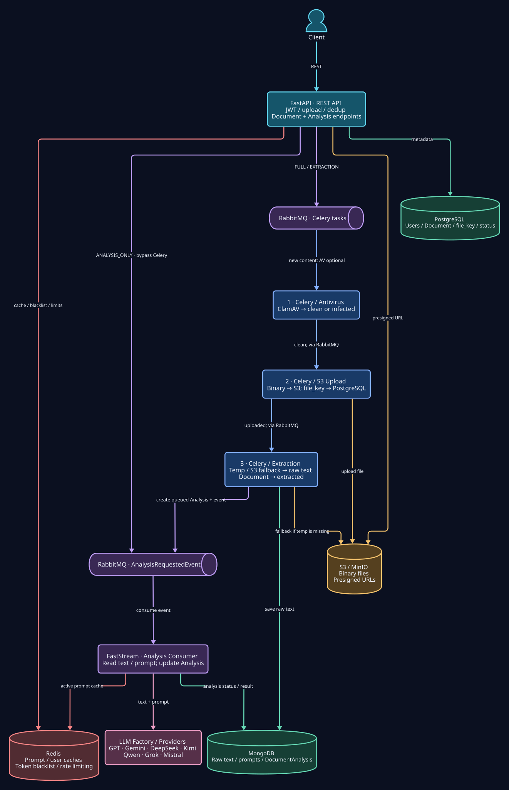
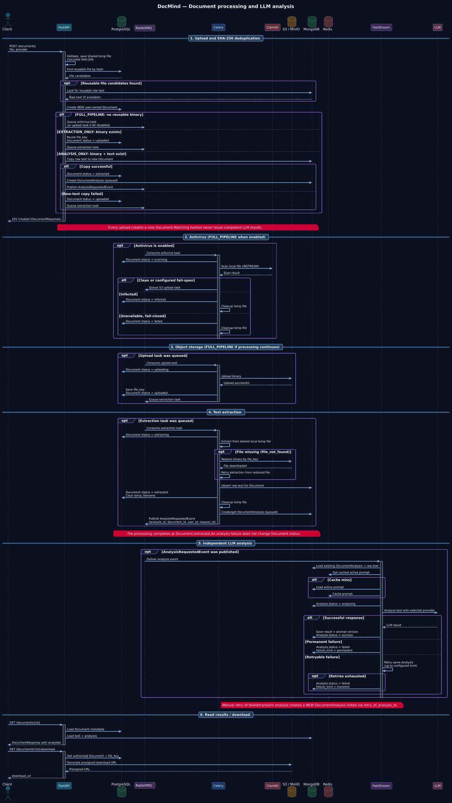

# DocMind

[](https://codecov.io/github/SadLaboka/DocMind)
[](https://sonarcloud.io/summary/new_code?id=SadLaboka_DocMind)
[](https://www.python.org/downloads/)
[](https://github.com/psf/black)
[](https://github.com/astral-sh/ruff)
[](https://mypy-lang.org/)

[](https://sonarcloud.io/summary/new_code?id=SadLaboka_DocMind)

🇷🇺 [Читать на русском](README_RU.md)

## Overview

**DocMind** is an asynchronous system for processing documents and analyzing their content with Large Language Models (LLMs). A FastAPI application handles uploads and user requests, Celery workers scan, store, and extract files, and a separate FastStream consumer performs LLM analysis.

DocMind separates a **Document** (user-owned metadata and extracted content) from a **DocumentAnalysis** (an independent LLM run). The initial deployment targets **one Docker Compose host**: the API and Celery workers share a temporary volume, while S3-compatible object storage preserves uploaded files.

## Table of Contents

- [Features](#features)
- [Tech Stack](#tech-stack)
- [Architecture](#architecture)
- [Data Flow](#data-flow)
- [Quick Start](#quick-start)
- [Useful Commands](#useful-commands)
- [Environment Variables](#environment-variables)
- [Testing](#testing)
- [Code Quality](#code-quality)
- [Database Migrations](#database-migrations)
- [Roadmap](#roadmap)
- [Usage Examples](#usage-examples)
- [License](#license)

<a id="features"></a>
## Features

- **Asynchronous pipeline**: FastAPI, Celery, and FastStream handle upload, antivirus scanning, object storage, text extraction, and LLM analysis in separate processes.
- **Configurable ClamAV scanning**: New file content is scanned before S3 upload when enabled. Infected files are marked `infected`; behavior on antivirus unavailability is configurable. Reused content is not scanned again.
- **S3-compatible storage**: MinIO for local development and configurable S3-compatible backends for deployment; presigned download URLs.
- **Text extraction**: `.txt`, `.docx`, `.xlsx`, and `.pdf` (including supported table extraction).
- **Content-based SHA-256 deduplication**: Every upload creates a new Document for the current user. Already stored binaries and available extracted text can be reused without repeating ClamAV or extraction; **every new Document gets a new LLM analysis**. An existing analysis result is never reused solely because the file hash matches.
- **Independent analysis history**: Multiple analyses per Document, provider selection, prompt version tracking, analysis filtering/pagination, and manual retry of eligible transient failures.
- **Seven LLM providers (Factory Pattern)**: GPT, Gemini, DeepSeek, Kimi, Qwen, Grok, and Mistral; responses are validated with Pydantic.
- **Retries and dead-letter configuration**: RabbitMQ routes analysis events; predefined transient failures can be retried. At-least-once message delivery is accounted for, but duplicate execution is not eliminated in every race.
- **Redis caching and rate limiting**: Prompt/user-status caches, token blacklist, and endpoint-specific request limits.
- **Security**: JWT RS256 authentication, token revocation, Argon2 password hashing, and document ownership checks.
- **Versioned prompts**: Admin-managed prompt versions and caching of the active prompt.

<a id="tech-stack"></a>
## Tech Stack

### Core & API
 **Python 3.13**

 **FastAPI** — REST API, Dependency Injection, Middlewares

- **Pydantic v2** — data validation and schemas
- **structlog** — structured JSON logging

### Databases & Caching
 **PostgreSQL** (SQLAlchemy + asyncpg) — users, user-owned Documents, and processing metadata

 **MongoDB** (Beanie) — raw text, versioned prompts, and independent DocumentAnalysis records

 **Redis** — prompt caching, user statuses, rate limiting, token blacklist

### Message Brokers & Async Tasks
 **RabbitMQ** (Kombu / aio-pika) — message broker

 **Celery** — workers for antivirus scanning, S3 upload, and text extraction

- **FastStream** — consumers for asynchronous text analysis via LLM

### LLM Providers
- **Kimi** (via OpenAI SDK)
- **Grok** (via OpenAI SDK)
- **GPT** (via OpenAI SDK)
- **Qwen** (via OpenAI SDK)
- **Mistral** (via OpenAI SDK)
- **DeepSeek** (via OpenAI SDK)
- **Gemini** (via google-genai)

### Infrastructure & DevOps
- **Docker & Docker Compose** — single-host service deployment
- **ClamAV** — antivirus scanning of uploaded files
- **MinIO / S3** — durable binary storage (MinIO locally; configurable S3-compatible service for deployment)
- **Poetry** — dependency management
- **Alembic** — PostgreSQL migrations
- **GitHub Actions** — automated coverage workflow with Codecov; deployment CI/CD is planned
- **pytest** — coverage for API, services, and workers

<a id="architecture"></a>
## Architecture

### Component Diagram



### Sequence Diagram: Document Lifecycle



<a id="data-flow"></a>
## Data Flow

### Upload and processing paths

1. **Validation and temporary storage (FastAPI).** `POST /documents/` validates filename, MIME type, and size (up to 50 MB), writes the upload to a temporary file, and calculates its SHA-256 hash. A new user-owned `Document` is created even when identical content exists elsewhere.
2. **Deduplication decision.** Processing follows one of three paths:
   - `FULL_PIPELINE`: no reusable file content is available; run ClamAV (if enabled), upload to S3/MinIO, extract text, and request a fresh LLM analysis.
   - `EXTRACTION_ONLY`: reuse a stored binary when no reusable raw text is available; extract it, then request a fresh analysis. Extraction can restore the missing local copy from S3.
   - `ANALYSIS_ONLY`: reuse the stored binary and extracted text for the new Document, skip ClamAV and extraction, then request a **new** analysis. If raw-text copying fails, the system can fall back to extraction.
3. **Scanning and object storage (Celery).** On the full path, a clean file is uploaded to S3-compatible storage and its `file_key` is recorded in PostgreSQL. The object key has the shape `documents/{temporary_filename}`. The Document progresses through `created`, `scanning` (when enabled), `uploading`, and `uploaded`.
4. **Text extraction (Celery).** Workers extract TXT/DOCX/XLSX/PDF content and store raw text in MongoDB. They first use the local temporary copy; if it is missing, they attempt an S3 download using the saved `file_key`. On success the Document becomes `extracted` and the temporary file is cleaned up.
5. **Analysis request.** A separate `DocumentAnalysis` is created with status `queued`. The publisher sends an `AnalysisRequestedEvent` containing `analysis_id`, `document_id`, `user_id`, and `request_id` through RabbitMQ.
6. **LLM analysis (FastStream).** The consumer validates the event and existing analysis, loads raw text and the active prompt, selects the configured provider, validates the LLM response, and updates the **Analysis** to `success` or `failed`. It does **not** change the Document's `extracted` status.
7. **Reading results (FastAPI).** REST endpoints return document metadata, optional extracted text, and related analyses. Separate endpoints support paginated analysis history, new analyses, eligible manual retries, and presigned download links.

### Document and analysis lifecycle

| Entity | Purpose | Main statuses |
|--------|---------|---------------|
| `Document` (PostgreSQL) | User-owned file metadata and preparation state | `created`, `scanning`, `uploading`, `uploaded`, `extracting`, `extracted`, plus `infected`, `failed`, `cancelled` |
| `DocumentAnalysis` (MongoDB) | A specific LLM execution, its provider, prompt version, result, and retry lineage | `queued`, `analyzing`, `success`, `failed` |

`extracted` means the Document is ready for analysis; it does **not** mean an LLM run succeeded. A failed analysis does not undo successful text extraction. A manual retry of a failed analysis is allowed only when `failure_kind=transient`; it creates a new Analysis linked through `retry_of_analysis_id`, rather than resetting the old one. New analyses may use a different provider or the currently active prompt version.

### Key architectural decisions

**Why PostgreSQL + MongoDB + Redis?**
- **PostgreSQL** holds relational user and Document metadata, including processing state and S3 keys.
- **MongoDB** stores extracted text, prompts, and separate LLM analysis histories.
- **Redis** supports caching, rate limiting, and token revocation.

**Why Celery + FastStream?**
- **Celery** handles file processing (antivirus, S3 upload, extraction) and retries for selected temporary failures.
- **FastStream** handles asynchronous LLM work and RabbitMQ event delivery, independently of file preparation.

**Why S3-compatible storage alongside a shared temporary volume?**
- **S3/MinIO** is the persistent source of file bytes and enables presigned downloads.
- **API and Celery share a temporary Docker volume on a single host** so extraction can reuse a local upload without a redundant S3 download.
- If the temporary copy is missing during extraction, the worker can restore it from S3. Temporary files are removed after terminal processing paths, subject to cleanup-error handling.
- A multi-host worker deployment with independently mounted temporary storage is **not** part of the current design.

<a id="quick-start"></a>
## Quick Start

### Prerequisites
- **Docker with Docker Compose v2**
- **Python 3.13 and Poetry** for `make up` and local development tooling
- **Make** for the shortcut commands (optional if using Docker Compose directly)

### Installation and startup

1. Clone the repository:
   ```bash
   git clone https://github.com/SadLaboka/DocMind.git
   cd DocMind
   ```
2. Prepare environment settings:
   ```bash
   cp .env.example .env
   # Replace placeholder API keys and secrets, and verify service connection settings.
   ```
3. Start the application:
   ```bash
   make up
   ```
   `make up` runs `scripts/docker_up.py`: if `STORAGE_BACKEND=local`, it enables the `local-storage` Compose profile for MinIO. The equivalent Docker command in that case is:
   ```bash
   docker compose --profile local-storage up -d --build
   ```
   With an external S3 backend the script uses `docker compose up -d --build` instead.
4. The HTTP API is exposed at `http://localhost:8000` when the configured containers start successfully.

> [!IMPORTANT]
> Check `.env.example` before first startup: its current RabbitMQ port/credential entries and some service addresses differ from the application settings and Compose service networking. The example configuration needs to be aligned before it can be treated as a verified one-command setup. This README update does not change application configuration.

### API documentation
- **Swagger UI:** `http://localhost:8000/openapi`
- **ReDoc:** `http://localhost:8000/redoc`

<a id="useful-commands"></a>
## Useful Commands

| Command | Description |
|---------|-------------|
| `make up` | Start Compose through `scripts/docker_up.py` (enables MinIO profile for local storage) |
| `make down` | Stop the default Compose services and remove volumes |
| `make down-all` | Stop services including the `local-storage` profile and remove volumes |
| `make down-soft` | Stop services without deleting volumes |
| `make test` | Run tests with the dedicated test Compose setup |
| `make cov` | Run coverage tests and write `coverage/coverage.xml` |
| `make cov-html` | Generate HTML coverage in `coverage/html`; automatic browser opening currently requires PowerShell |
| `make lint` | Run pre-commit hooks in Docker |
| `make format` | Run Ruff lint fixes and formatting on `src/` |
| `make typecheck` | Run mypy on `src/` |
| `make logs` / `make logs-worker` | Follow API or Celery worker logs |
| `make logs-app` / `make logs-all` | Follow app-related services or all services |

<a id="environment-variables"></a>
## Environment Variables

Configuration is read via Pydantic settings and Docker Compose. **The values below are examples from `.env.example` unless explicitly noted; they are not necessarily Pydantic defaults or valid inter-container addresses.** See `src/core/config.py` for application defaults and `docker-compose.yaml` for service-level overrides.

The current `.env.example` still requires reconciliation with application settings and Compose networking (notably the RabbitMQ AMQP port/credentials and external-storage endpoint variable names).

### Server
| Variable | Description | Example / configuration note |
|----------|-------------|---------|
| `SERVER_HOST` | Application host | `127.0.0.1` |
| `SERVER_PORT` | Application port | `8000` |
| `SERVER_RELOAD` | Auto-reload on code changes | `true` |

### Databases
| Variable | Description | Example / configuration note |
|----------|-------------|---------|
| `DB_USER` / `DB_PASSWORD` / `DB_NAME` | PostgreSQL credentials | `postgres` / `postgres` / `postgres` |
| `DB_HOST` / `DB_PORT` | PostgreSQL connection | `localhost` / `5432` |
| `MONGO_USERNAME` / `MONGO_PASSWORD` | MongoDB credentials | `root` / `example` |
| `MONGO_HOST` / `MONGO_PORT` / `MONGO_NAME` | MongoDB connection | `127.0.0.1` / `27017` / `DocMind` |
| `REDIS_HOST` / `REDIS_PORT` / `REDIS_DB` | Redis connection | `localhost` / `6379` / `0` |

### Message Broker
| Variable | Description | Example / configuration note |
|----------|-------------|---------|
| `RABBITMQ_USER` / `RABBITMQ_PASSWORD` | Broker credentials used by application settings and Compose | `guest` / `guest`; `.env.example` currently uses mismatched names |
| `RABBITMQ_HOST` / `RABBITMQ_PORT` | AMQP connection (management UI uses a separate port) | `rabbitmq` / `5672` inside Compose; `.env.example` currently specifies `127.0.0.1` / `15672` |

### JWT Authentication
| Variable | Description | Example / configuration note |
|----------|-------------|---------|
| `JWT_ALGORITHM` | Signing algorithm | `RS256` |
| `JWT_TIMEDELTA` | Access token lifetime (minutes) | `15` |
| `JWT_REFRESH_TIMEDELTA` | Refresh token lifetime (days) | `7` |

### Antivirus (ClamAV)
| Variable | Description | Example / configuration note |
|----------|-------------|---------|
| `ANTIVIRUS_ENABLED` | Enable antivirus scanning | `true` |
| `ANTIVIRUS_HOST` | ClamAV host | `clamav` |
| `ANTIVIRUS_PORT` | ClamAV port | `3310` |
| `ANTIVIRUS_TIMEOUT` | Scan timeout (seconds) | `60` |
| `ANTIVIRUS_FAIL_ON_UNAVAILABLE` | Fail if ClamAV is unavailable | `false` |
| `ANTIVIRUS_CHUNK_SIZE` | Stream chunk size (bytes) | `4096` |

### Storage (S3 / MinIO)
| Variable | Description | Example / configuration note |
|----------|-------------|---------|
| `STORAGE_BACKEND` | Storage backend (`local` or `s3`) | `local` |
| `LOCAL_STORAGE_ENDPOINT_URL` | MinIO endpoint URL | `http://minio:9000` |
| `LOCAL_STORAGE_EXTERNAL_ENDPOINT_URL` | MinIO external URL (for presigned URLs) | `http://localhost:9000`; `.env.example` uses the wrong prefix (`LOCAL_EXTERNAL_ENDPOINT_URL`) |
| `LOCAL_STORAGE_ACCESS_KEY` | MinIO access key | `access_key` placeholder |
| `LOCAL_STORAGE_SECRET_KEY` | MinIO secret key | `secret_key` placeholder |
| `LOCAL_STORAGE_REGION` | MinIO region | `us-east-1` |
| `LOCAL_STORAGE_BUCKET` | MinIO bucket name | `docmind` |
| `LOCAL_STORAGE_PRESIGNED_URL_TTL` | Presigned URL TTL (seconds) | `600` |
| `LOCAL_STORAGE_LIFECYCLE_DAYS` | Object lifecycle setting (days) | `1` |
| `LOCAL_STORAGE_SSE_ENABLED` | Enable server-side encryption | `false` |
| `NONLOCAL_STORAGE_ENDPOINT_URL` | S3 endpoint URL (production) | `https://s3.selcloud.ru` |
| `NONLOCAL_STORAGE_EXTERNAL_ENDPOINT_URL` | S3 external URL (production) | `https://s3.selcloud.ru`; `.env.example` uses the wrong prefix (`NONLOCAL_EXTERNAL_ENDPOINT_URL`) |
| `NONLOCAL_STORAGE_ACCESS_KEY` | S3 access key (production) | — |
| `NONLOCAL_STORAGE_SECRET_KEY` | S3 secret key (production) | — |
| `NONLOCAL_STORAGE_REGION` | S3 region (production) | `us-east-1` in `.env.example`; code default: `ru-1` |
| `NONLOCAL_STORAGE_BUCKET` | S3 bucket name (production) | `docmind` |
| `NONLOCAL_STORAGE_PRESIGNED_URL_TTL` | Presigned URL TTL (seconds) | `3600` |
| `NONLOCAL_STORAGE_LIFECYCLE_DAYS` | Object lifecycle setting (days) | `30` |
| `NONLOCAL_STORAGE_SSE_ENABLED` | Enable server-side encryption | `true` |

### LLM Providers
| Variable | Description | Example / configuration note |
|----------|-------------|---------|
| `LLM_DEFAULT_PROVIDER` | Default provider for analysis | `deepseek` |

#### Kimi (Moonshot AI)
| Variable | Description | Example / configuration note |
|----------|-------------|---------|
| `KIMI_API_KEY` | Kimi API key | — |
| `KIMI_MODEL` | Model name | `K-3` |
| `KIMI_BASE_URL` | API base URL | `https://api.moonshot.ai/v1` |
| `KIMI_TIMEOUT` | Request timeout (seconds) | `60` |
| `KIMI_MAX_TOKENS` | Maximum output tokens | `4096` |
| `KIMI_TEMPERATURE` | Sampling temperature | `0.2` |

#### Grok (xAI)
| Variable | Description | Example / configuration note |
|----------|-------------|---------|
| `GROK_API_KEY` | Grok API key | — |
| `GROK_MODEL` | Model name | `grok-4.5` |
| `GROK_BASE_URL` | API base URL | `https://api.x.ai/v1` |
| `GROK_TIMEOUT` | Request timeout (seconds) | `60` |
| `GROK_MAX_TOKENS` | Maximum output tokens | `4096` |
| `GROK_TEMPERATURE` | Sampling temperature | `0.2` |

#### GPT (OpenAI)
| Variable | Description | Example / configuration note |
|----------|-------------|---------|
| `GPT_API_KEY` | OpenAI API key | — |
| `GPT_MODEL` | Model name | `gpt-5.5-2026-04-23` |
| `GPT_BASE_URL` | API base URL | `https://api.openai.com/v1` |
| `GPT_TIMEOUT` | Request timeout (seconds) | `45` |
| `GPT_MAX_TOKENS` | Maximum output tokens | `4096` |
| `GPT_TEMPERATURE` | Sampling temperature | `0.2` |

#### Qwen (Alibaba)
| Variable | Description | Example / configuration note |
|----------|-------------|---------|
| `QWEN_API_KEY` | Qwen API key (DashScope) | — |
| `QWEN_MODEL` | Model name | `qwen3.7-plus` |
| `QWEN_BASE_URL` | API base URL | `https://dashscope-intl.aliyuncs.com/compatible-mode/v1` |
| `QWEN_TIMEOUT` | Request timeout (seconds) | `60` |
| `QWEN_MAX_TOKENS` | Maximum output tokens | `8192` |
| `QWEN_TEMPERATURE` | Sampling temperature | `0.15` |

#### Mistral AI
| Variable | Description | Example / configuration note |
|----------|-------------|---------|
| `MISTRAL_API_KEY` | Mistral API key | — |
| `MISTRAL_MODEL` | Model name | `mistral-small-2603` |
| `MISTRAL_BASE_URL` | API base URL | `https://api.mistral.ai/v1` |
| `MISTRAL_TIMEOUT` | Request timeout (seconds) | `60` |
| `MISTRAL_MAX_TOKENS` | Maximum output tokens | `4096` |
| `MISTRAL_TEMPERATURE` | Sampling temperature | `0.15` |

#### Gemini (Google)
| Variable | Description | Example / configuration note |
|----------|-------------|---------|
| `GEMINI_API_KEY` | Google Gemini API key | — |
| `GEMINI_MODEL` | Model name | `gemini-3.1-flash-lite` |
| `GEMINI_TIMEOUT` | Request timeout (seconds) | `60` |
| `GEMINI_MAX_TOKENS` | Maximum output tokens | `4096` |
| `GEMINI_TEMPERATURE` | Sampling temperature | `0.2` |

#### DeepSeek
| Variable | Description | Example / configuration note |
|----------|-------------|---------|
| `DEEPSEEK_API_KEY` | DeepSeek API key | — |
| `DEEPSEEK_MODEL` | Model name | `deepseek-v4-flash` |
| `DEEPSEEK_BASE_URL` | API base URL | `https://api.deepseek.com` |
| `DEEPSEEK_TIMEOUT` | Request timeout (seconds) | `60` |
| `DEEPSEEK_MAX_TOKENS` | Maximum output tokens | `8192` |
| `DEEPSEEK_TEMPERATURE` | Sampling temperature | `0.2` |

### Rate Limiting
| Variable | Description | Example / configuration note |
|----------|-------------|---------|
| `RATE_LIMIT_GLOBAL_LIMIT` / `RATE_LIMIT_GLOBAL_WINDOW` | Global limit (requests / time window in seconds) | `60` / `60` |
| `RATE_LIMIT_LOGIN_LIMIT` / `RATE_LIMIT_LOGIN_WINDOW` | Login endpoint limit | `5` / `60` |
| `RATE_LIMIT_REGISTER_LIMIT` / `RATE_LIMIT_REGISTER_WINDOW` | Register endpoint limit | `3` / `60` |
| `RATE_LIMIT_DOCUMENTS_POST_LIMIT` / `..._WINDOW` | Upload endpoint limit | `10` / `60` |
| `RATE_LIMIT_DOCUMENTS_GET_LIMIT` / `..._WINDOW` | Document list endpoint limit | `20` / `60` |
| `RATE_LIMIT_ANALYSES_GET_LIMIT` / `..._WINDOW` | Analysis GET limit | `20` / `60` |
| `RATE_LIMIT_ANALYSES_POST_LIMIT` / `..._WINDOW` | Analysis POST limit | `10` / `60` |

### Caching
| Variable | Description | Example / configuration note |
|----------|-------------|---------|
| `CACHE_PROMPT_TTL` | Prompt cache TTL (seconds) | `3600` |
| `CACHE_USER_STATUS_TTL` | User status cache TTL (seconds) | `3600` |

---

<a id="testing"></a>
## Testing

The project has unit and integration tests and a dedicated test Docker Compose configuration:

```bash
make test
```

Generate a terminal/XML coverage report:

```bash
make cov
# XML output: ./coverage/coverage.xml
```

Generate HTML coverage:

```bash
make cov-html
# HTML output: ./coverage/html/index.html
```

`make cov-html` uses PowerShell to open the result automatically; on other hosts, open the generated `index.html` manually. Some worker and API regression tests are still planned and are not claimed as completed.

<a id="code-quality"></a>
## Code Quality

Run linters and type checks:
```bash
make lint        # pre-commit hooks in Docker
make format      # ruff check + format
make typecheck   # mypy
```

---

<a id="database-migrations"></a>
## 🗄 Database Migrations

PostgreSQL schema is managed via **Alembic**.

Create a new migration:
```bash
make migrate-new m="add_new_field"
# Or: poetry run alembic revision --autogenerate -m "add_new_field"
```

Apply all pending migrations:
```bash
make migrate-up
# Or: poetry run alembic upgrade head
```

Rollback the last migration:
```bash
make migrate-down
# Or: poetry run alembic downgrade -1
```

> [!IMPORTANT]
> During `make up`, migrations are applied automatically via the `db-migrate` service. You only need to run these commands manually when developing locally.

---

<a id="roadmap"></a>
## Roadmap

### Implemented
- [x] FastAPI + Celery + FastStream asynchronous processing
- [x] TXT, DOCX, XLSX, and PDF text extraction
- [x] LLM Factory supporting GPT, Gemini, DeepSeek, Kimi, Qwen, Grok, and Mistral
- [x] SHA-256 content deduplication with separate user-owned Documents and fresh LLM runs
- [x] Independent DocumentAnalysis lifecycle and analysis history API
- [x] Manual retry of analyses that failed for transient reasons
- [x] Prompt versioning and admin functionality
- [x] Configurable ClamAV scanning and S3/MinIO storage with presigned downloads
- [x] Local-first extraction with S3 restore when the temporary file is missing
- [x] JWT RS256, token blacklist, Redis caching, and rate limiting

### Planned / follow-up
- [ ] **WebSockets** for near-real-time Document and Analysis updates
- [ ] Email notifications and Telegram bot
- [ ] Prometheus, Grafana, and Loki observability
- [ ] Extended CI/CD for image builds and deployment
- [ ] Document comparison, OCR for scanned files, specialized parsing

<a id="usage-examples"></a>
## Usage Examples

Basic flow: register → login → upload → inspect Document and Analysis → optionally start another analysis.

### 1. Register

```bash
curl -X POST http://localhost:8000/users/register \
  -H "Content-Type: application/json" \
  -d '{"login":"john_doe","email":"john@example.com","password":"SecurePass123!"}'
```

### 2. Login

```bash
curl -X POST http://localhost:8000/auth/login \
  -H "Content-Type: application/json" \
  -d '{"login":"john_doe","password":"SecurePass123!"}'
```

The response includes `access_token`, `refresh_token`, and `token_type`. Set `<access_token>` in the following examples to your access token.

### 3. Upload

```bash
curl -X POST http://localhost:8000/documents/ \
  -H "Authorization: Bearer <access_token>" \
  -F "file=@contract.pdf" \
  -F "description=Q3 supplier contract" \
  -F "provider=deepseek"
```

The `provider` form field is optional and defaults to `LLM_DEFAULT_PROVIDER`. Upload size is limited to 50 MB. An identical SHA-256 hash allows stored content to be reused, **not the previous LLM result**; the current user receives a new Document and a new analysis is requested.

### 4. List documents

```bash
curl -X GET "http://localhost:8000/documents/?page=1&limit=20" \
  -H "Authorization: Bearer <access_token>"
```

The result includes `items`, `total`, `page`, `limit`, and `has_next`. The document list contains metadata rather than the full analysis history.

### 5. Get a document and its analyses

```bash
curl -X GET http://localhost:8000/documents/42 \
  -H "Authorization: Bearer <access_token>"
```

Example response **after extraction and a successful LLM run** (illustrative IDs and timestamps):

```json
{
  "id": 42,
  "user_id": 7,
  "filename": "contract.pdf",
  "description": "Q3 supplier contract",
  "mime_type": "application/pdf",
  "file_size": 102400,
  "document_status": "extracted",
  "document_text": "Extracted contract text...",
  "created_at": "2026-10-11T10:30:00Z",
  "updated_at": "2026-10-11T10:30:20Z",
  "analyses": [
    {
      "id": "68e9f6a01234567890abcdef",
      "provider": "deepseek",
      "prompt_version": "v1.0.0",
      "result": {
        "summary": "Supplier contract for Q3...",
        "keywords": ["contract", "supplier"],
        "document_type": "contract",
        "entities": {"organizations": ["Example Corp"]},
        "confidence": 0.92,
        "raw_response": "{...}"
      },
      "status": "success",
      "failure_kind": null,
      "error_code": null,
      "created_at": "2026-10-11T10:30:20Z",
      "updated_at": "2026-10-11T10:31:20Z",
      "retry_of_analysis_id": null
    }
  ]
}
```

A Document may be `extracted` while an analysis is still `queued`, `analyzing`, or `failed`.

### 6. Browse analysis history

```bash
curl -X GET "http://localhost:8000/documents/42/analyses/?page=1&limit=10&statuses=success" \
  -H "Authorization: Bearer <access_token>"
```

The paginated response has `analyses`, `page`, `limit`, and `has_next`. You can also filter by `providers` and request a single analysis with `GET /documents/{document_id}/analyses/{analysis_id}`.

### 7. Start a new analysis with another provider

```bash
curl -X POST http://localhost:8000/documents/42/analyses/ \
  -H "Authorization: Bearer <access_token>" \
  -H "Content-Type: application/json" \
  -d '{"provider":"gpt"}'
```

Returns `201 Created` with a new `AnalysisResponse`. It requires an extracted Document with raw text; no new antivirus scan or text extraction is triggered.

### 8. Manually retry a transiently failed analysis

```bash
curl -X POST http://localhost:8000/documents/42/analyses/<analysis_id>/retry \
  -H "Authorization: Bearer <access_token>"
```

Only `failed` analyses with `failure_kind=transient` are eligible. Each analysis may have at most one direct retry child. The API returns a new Analysis linked by `retry_of_analysis_id`.

### 9. Get a presigned download URL

```bash
curl -X GET http://localhost:8000/documents/42/download \
  -H "Authorization: Bearer <access_token>"
```

Response: `{"download_url":"http://localhost:9000/docmind/documents/<key>?..."}`. The URL expires after the configured TTL (600 seconds for local storage in `.env.example`; 3600 seconds for nonlocal storage).

### 10. Refresh and revoke tokens

```bash
curl -X POST http://localhost:8000/auth/refresh \
  -H "Authorization: Bearer <refresh_token>"

curl -X POST http://localhost:8000/auth/logout \
  -H "Authorization: Bearer <access_token>"
```

All document and analysis endpoints check document access for the current user.

<a id="license"></a>
## License

This project is licensed under the **GNU Affero General Public License v3.0 (AGPL-3.0)** — see the [LICENSE](LICENSE) file for details.

The AGPL-3.0 requires that if you modify this software and run it on a network server, you must make the source code of your modified version available to the users of that server.
