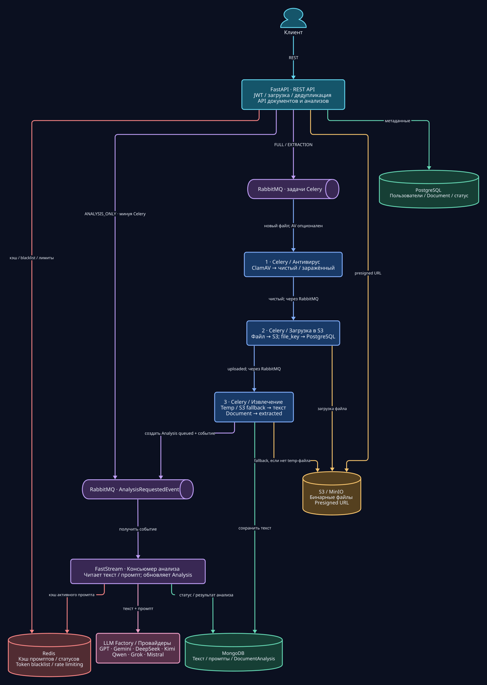
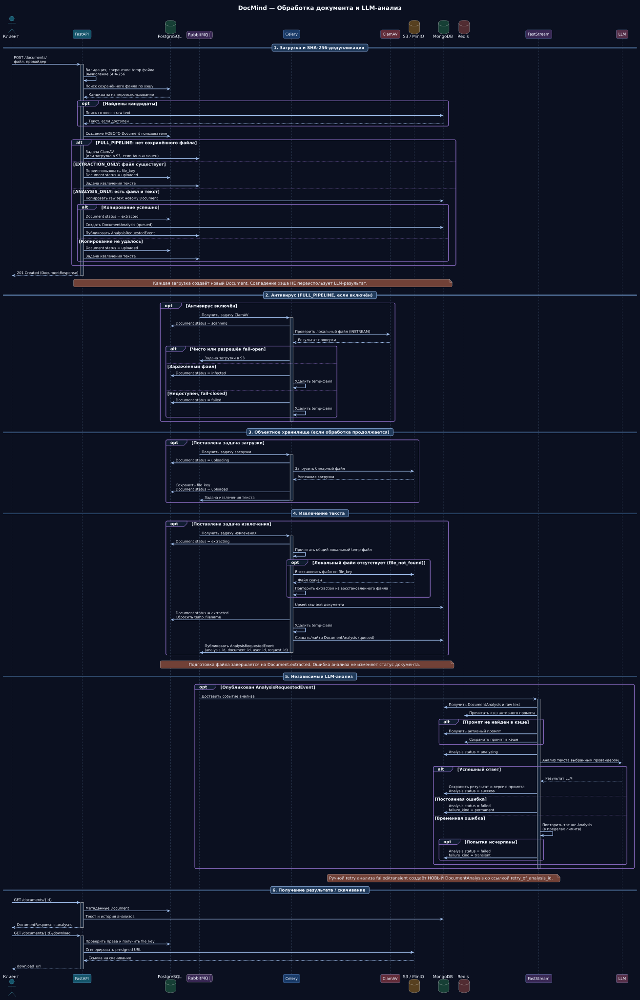

# DocMind

[](https://codecov.io/github/SadLaboka/DocMind)
[](https://sonarcloud.io/summary/new_code?id=SadLaboka_DocMind)
[](https://www.python.org/downloads/)
[](https://github.com/psf/black)
[](https://github.com/astral-sh/ruff)
[](https://mypy-lang.org/)

[](https://sonarcloud.io/summary/new_code?id=SadLaboka_DocMind)

🇬🇧 [Read in English](README.md)

## Обзор

**DocMind** — асинхронная система обработки документов и анализа их содержимого с помощью больших языковых моделей (LLM). Приложение FastAPI принимает файлы и пользовательские запросы, Celery-воркеры проверяют файлы, сохраняют их и извлекают текст, а отдельный FastStream-консьюмер выполняет LLM-анализ.

В системе разделены **Document** (метаданные документа пользователя и подготовленный текст) и **DocumentAnalysis** (отдельный запуск LLM). Первая версия рассчитана на **один хост с Docker Compose**: API и Celery используют общий временный volume, а бинарные файлы сохраняются в S3-совместимом хранилище.

## Содержание

- [Возможности](#features)
- [Технологический стек](#tech-stack)
- [Архитектура](#architecture)
- [Поток данных](#data-flow)
- [Быстрый старт](#quick-start)
- [Полезные команды](#useful-commands)
- [Переменные окружения](#environment-variables)
- [Тестирование](#testing)
- [Качество кода](#code-quality)
- [Миграции базы данных](#database-migrations)
- [Roadmap](#roadmap)
- [Примеры использования](#usage-examples)
- [Лицензия](#license)

<a id="features"></a>
## Возможности

- **Асинхронный pipeline**: FastAPI, Celery и FastStream отдельно обрабатывают загрузку, антивирусную проверку, сохранение файла, извлечение текста и LLM-анализ.
- **Настраиваемая проверка ClamAV**: Новый файл проверяется перед отправкой в S3, если антивирус включён. Для заражённых файлов используется статус `infected`; поведение при недоступности ClamAV настраивается. Повторно используемое содержимое не сканируется заново.
- **S3-совместимое хранилище**: MinIO для локальной разработки и настраиваемый S3-совместимый сервис для размещения системы; временные presigned URL для скачивания.
- **Извлечение текста**: `.txt`, `.docx`, `.xlsx` и `.pdf`, включая поддерживаемую обработку таблиц.
- **SHA-256-дедупликация содержимого**: При каждой загрузке создаётся новый `Document` текущего пользователя. Уже сохранённый бинарный файл и доступный извлечённый текст могут использоваться повторно без нового запуска ClamAV и extraction. **Новый LLM-анализ запускается всегда**; предыдущий результат не переиспользуется только из-за совпадения хэша.
- **Независимая история анализов**: Несколько `DocumentAnalysis` для одного документа, выбор провайдера, фиксация версии промпта, фильтрация и пагинация, ручной retry допустимых временных ошибок.
- **Семь LLM-провайдеров (Factory Pattern)**: GPT, Gemini, DeepSeek, Kimi, Qwen, Grok и Mistral; проверка результатов через Pydantic.
- **Повторы задач и dead-letter-конфигурация**: RabbitMQ передаёт события анализа; заранее определённые временные ошибки могут приводить к retry. Система учитывает повторную доставку сообщений, но не исключает всякое повторное выполнение при гонках.
- **Redis и rate limiting**: Кэши промптов и статусов пользователей, blacklist токенов, отдельные лимиты API.
- **Безопасность**: JWT RS256, отзыв токенов, Argon2 и проверка доступа пользователя к документу.
- **Версионирование промптов**: Управление версиями из админского API и кэширование активной версии.

<a id="tech-stack"></a>
## Технологический стек

### Core & API
 **Python 3.13**

 **FastAPI** — REST API, Dependency Injection, Middlewares

- **Pydantic v2** — валидация данных и схемы
- **structlog** — структурированное логирование в JSON

### Базы данных и кэширование
 **PostgreSQL** (SQLAlchemy + asyncpg) — пользователи, документы и статусы их обработки

 **MongoDB** (Beanie) — извлечённый текст, версии промптов и независимые записи DocumentAnalysis

 **Redis** — кэширование промптов, статусов пользователей, rate limiting, token blacklist

### Брокеры сообщений и асинхронные задачи
 **RabbitMQ** (Kombu / aio-pika) — брокер очередей

 **Celery** — воркеры антивирусной проверки, загрузки в S3 и извлечения текста

- **FastStream** — консьюмеры для асинхронного анализа текста через LLM

### LLM-провайдеры
- **Kimi** (через OpenAI SDK)
- **Grok** (через OpenAI SDK)
- **GPT** (через OpenAI SDK)
- **Qwen** (через OpenAI SDK)
- **Mistral** (через OpenAI SDK)
- **DeepSeek** (через OpenAI SDK)
- **Gemini** (через google-genai)

### Инфраструктура и DevOps
- **Docker & Docker Compose** — запуск сервисов на одном хосте
- **ClamAV** — антивирусная проверка загружаемых файлов
- **MinIO / S3** — долговременное хранение бинарных файлов (локально MinIO, для размещения — настраиваемое S3-совместимое хранилище)
- **Poetry** — управление зависимостями
- **Alembic** — миграции PostgreSQL
- **GitHub Actions** — проверка покрытия с Codecov; полноценный CI/CD с деплоем запланирован
- **pytest** — покрытие API, сервисов и воркеров

<a id="architecture"></a>
## Архитектура

### Диаграмма компонентов




### Диаграмма последовательности: Жизненный цикл документа



> [!NOTE]
> Диаграммы пока отражают предыдущую модель жизненного цикла документа и анализа. Исходники схем и SVG обновим отдельно.

<a id="data-flow"></a>
## Поток данных

### Загрузка и маршруты обработки

1. **Проверка и временное сохранение (FastAPI).** `POST /documents/` проверяет имя, MIME-тип и размер файла (до 50 МБ), сохраняет его во временный файл и вычисляет SHA-256. Даже если такое содержимое уже существует в системе, создаётся отдельный `Document` текущего пользователя.
2. **Выбор маршрута дедупликации.** Возможны три сценария:
   - `FULL_PIPELINE`: пригодного для повторного использования файла нет — ClamAV (если включён), загрузка в S3/MinIO, extraction и новый LLM-анализ.
   - `EXTRACTION_ONLY`: бинарный файл уже сохранён, но доступного извлечённого текста нет — повторно извлекаем текст и запускаем новый анализ. При отсутствии локальной копии extraction может восстановить её из S3.
   - `ANALYSIS_ONLY`: бинарный файл и извлечённый текст переиспользуются для нового `Document`; ClamAV и extraction не запускаются, но **новый LLM-анализ создаётся обязательно**. Если скопировать текст не удалось, возможен переход к extraction.
3. **Антивирус и объектное хранилище (Celery).** На полном маршруте чистый файл загружается в S3, а `file_key` записывается в PostgreSQL. Формат ключа: `documents/{temporary_filename}`. Документ проходит статусы `created`, `scanning` (если включён), `uploading`, `uploaded`.
4. **Извлечение текста (Celery).** Воркер читает TXT/DOCX/XLSX/PDF и сохраняет текст в MongoDB. Обычно используется локальная временная копия; при её отсутствии файл скачивается из S3 по сохранённому `file_key`. После успеха `Document` получает статус `extracted`, а временный файл удаляется.
5. **Создание анализа.** Создаётся отдельный `DocumentAnalysis` со статусом `queued`. Через RabbitMQ публикуется `AnalysisRequestedEvent` с полями `analysis_id`, `document_id`, `user_id` и `request_id`.
6. **LLM-анализ (FastStream).** Консьюмер проверяет событие и существующий анализ, получает текст и активный промпт, вызывает выбранный LLM, валидирует ответ и переводит **Analysis** в `success` или `failed`. Статус `Document.extracted` не изменяется.
7. **Получение результатов (FastAPI).** REST API возвращает метаданные документа, при наличии — извлечённый текст, список анализов. Отдельные методы позволяют получать историю анализов с пагинацией, создавать новые анализы, повторять допустимые ошибки и скачивать исходный файл по presigned URL.

### Жизненные циклы Document и DocumentAnalysis

| Сущность | Ответственность | Основные статусы |
|----------|-----------------|------------------|
| `Document` (PostgreSQL) | Метаданные файла пользователя и подготовка текста | `created`, `scanning`, `uploading`, `uploaded`, `extracting`, `extracted`, а также `infected`, `failed`, `cancelled` |
| `DocumentAnalysis` (MongoDB) | Конкретный запуск LLM: провайдер, версия промпта, результат и связь повторов | `queued`, `analyzing`, `success`, `failed` |

Статус `extracted` означает, что документ подготовлен для анализа, но **не гарантирует успешный ответ LLM**. Ошибка анализа не отменяет успешное извлечение текста. Ручной retry возможен только для анализа в состоянии `failed` с `failure_kind=transient`; создаётся новая запись со ссылкой `retry_of_analysis_id`. Новый анализ может выполняться другим провайдером или с новой активной версией промпта.

### Ключевые архитектурные решения

**Почему PostgreSQL + MongoDB + Redis?**
- **PostgreSQL** хранит пользователей, документы, статусы обработки и S3-ключи.
- **MongoDB** хранит извлечённый текст, промпты и отдельные истории LLM-анализов.
- **Redis** используется для кэширования, rate limiting и отзыва токенов.

**Почему Celery + FastStream?**
- **Celery** отвечает за обработку файлов (антивирус, S3 upload, extraction) и повторы некоторых временных ошибок.
- **FastStream** отдельно выполняет LLM-анализ и обрабатывает события из RabbitMQ.

**Почему S3-совместимое хранилище и общий временный volume одновременно?**
- **S3/MinIO** — долговременный источник бинарного содержимого и основа для presigned URL.
- **API и Celery используют общий временный Docker volume на одном хосте**: обычно extraction не скачивает файл из S3 повторно.
- Если локальная копия отсутствует, воркер может восстановить её из S3. На конечных маршрутах временные файлы удаляются; ошибка cleanup не должна маскировать основную ошибку.
- Распределённая multi-host-конфигурация с независимыми временными хранилищами не входит в текущий дизайн.

<a id="quick-start"></a>
## Быстрый старт

### Требования
- **Docker и Docker Compose v2**
- **Python 3.13 и Poetry** для `make up` и локальных инструментов разработки
- **Make** для сокращённых команд (необязателен при прямом использовании Docker Compose)

### Установка и запуск

1. Клонируйте репозиторий:
   ```bash
   git clone https://github.com/SadLaboka/DocMind.git
   cd DocMind
   ```
2. Подготовьте окружение:
   ```bash
   cp .env.example .env
   # Укажите настоящие API-ключи, секреты и проверьте параметры подключения сервисов.
   ```
3. Запустите приложение:
   ```bash
   make up
   ```
   `make up` запускает `scripts/docker_up.py`: если `STORAGE_BACKEND=local`, включается профиль Compose `local-storage` с MinIO. Эквивалентная команда для этого режима:
   ```bash
   docker compose --profile local-storage up -d --build
   ```
   При внешнем S3 скрипт запускает `docker compose up -d --build` без профиля MinIO.
4. При успешном запуске HTTP API будет доступен на `http://localhost:8000`.

> [!IMPORTANT]
> Перед первым запуском нужно проверить `.env.example`: текущие переменные RabbitMQ (порт и имена учётных данных) и некоторые адреса сервисов расходятся с настройками приложения и сетью Compose. Пример конфигурации требует отдельного согласования; обновление README не изменяет конфигурацию приложения.

### Документация API
- **Swagger UI:** `http://localhost:8000/openapi`
- **ReDoc:** `http://localhost:8000/redoc`

<a id="useful-commands"></a>
## Полезные команды

| Команда | Описание |
|---------|----------|
| `make up` | Запуск Compose через `scripts/docker_up.py` (с профилем MinIO при локальном S3) |
| `make down` | Остановка сервисов стандартного профиля и удаление томов |
| `make down-all` | Остановка сервисов, включая `local-storage`, и удаление томов |
| `make down-soft` | Остановка сервисов без удаления томов |
| `make test` | Тесты через отдельную Compose-конфигурацию |
| `make cov` | Тесты с покрытием и отчётом `coverage/coverage.xml` |
| `make cov-html` | Генерация `coverage/html`; автоматическое открытие сейчас требует PowerShell |
| `make lint` | Pre-commit хуки в Docker |
| `make format` | Исправления Ruff и форматирование `src/` |
| `make typecheck` | Проверка mypy для `src/` |
| `make logs` / `make logs-worker` | Логи API или Celery |
| `make logs-app` / `make logs-all` | Логи процессов приложения или всех сервисов |

<a id="environment-variables"></a>
## Переменные окружения

Конфигурация загружается через Pydantic settings и Docker Compose. **В таблицах ниже приведены значения из `.env.example`, а не обязательно дефолты Pydantic или корректные адреса внутри контейнерной сети.** Дефолты приложения описаны в `src/core/config.py`, а переопределения сервисов — в `docker-compose.yaml`.

Текущий `.env.example` ещё нужно согласовать с настройками приложения и Compose (особенно AMQP-порт и учётные данные RabbitMQ, а также имена переменных внешних S3 endpoint).

### Сервер
| Переменная | Описание | Пример / примечание |
|------------|----------|--------------|
| `SERVER_HOST` | Хост приложения | `127.0.0.1` |
| `SERVER_PORT` | Порт приложения | `8000` |
| `SERVER_RELOAD` | Автоперезагрузка при изменении кода | `true` |

### Базы данных
| Переменная | Описание | Пример / примечание |
|------------|----------|--------------|
| `DB_USER` / `DB_PASSWORD` / `DB_NAME` | Учётные данные PostgreSQL | `postgres` / `postgres` / `postgres` |
| `DB_HOST` / `DB_PORT` | Подключение к PostgreSQL | `localhost` / `5432` |
| `MONGO_USERNAME` / `MONGO_PASSWORD` | Учётные данные MongoDB | `root` / `example` |
| `MONGO_HOST` / `MONGO_PORT` / `MONGO_NAME` | Подключение к MongoDB | `127.0.0.1` / `27017` / `DocMind` |
| `REDIS_HOST` / `REDIS_PORT` / `REDIS_DB` | Подключение к Redis | `localhost` / `6379` / `0` |

### Брокер сообщений
| Переменная | Описание | Пример / примечание |
|------------|----------|--------------|
| `RABBITMQ_USER` / `RABBITMQ_PASSWORD` | Учётные данные приложения и Compose | `guest` / `guest`; в `.env.example` указаны другие имена переменных |
| `RABBITMQ_HOST` / `RABBITMQ_PORT` | Подключение AMQP (панель управления — отдельный порт) | `rabbitmq` / `5672` внутри Compose; в `.env.example` сейчас `127.0.0.1` / `15672` |

### JWT-аутентификация
| Переменная | Описание | Пример / примечание |
|------------|----------|--------------|
| `JWT_ALGORITHM` | Алгоритм подписи | `RS256` |
| `JWT_TIMEDELTA` | Время жизни access-токена (минуты) | `15` |
| `JWT_REFRESH_TIMEDELTA` | Время жизни refresh-токена (дни) | `7` |

### Антивирус (ClamAV)
| Переменная | Описание | Пример / примечание |
|------------|----------|--------------|
| `ANTIVIRUS_ENABLED` | Включить антивирусную проверку | `true` |
| `ANTIVIRUS_HOST` | Хост ClamAV | `clamav` |
| `ANTIVIRUS_PORT` | Порт ClamAV | `3310` |
| `ANTIVIRUS_TIMEOUT` | Таймаут сканирования (секунды) | `60` |
| `ANTIVIRUS_FAIL_ON_UNAVAILABLE` | Ошибка при недоступности ClamAV | `false` |
| `ANTIVIRUS_CHUNK_SIZE` | Размер чанка стрима (байты) | `4096` |

### Хранилище (S3 / MinIO)
| Переменная | Описание | Пример / примечание |
|------------|----------|--------------|
| `STORAGE_BACKEND` | Тип хранилища (`local` или `s3`) | `local` |
| `LOCAL_STORAGE_ENDPOINT_URL` | Внутренний URL MinIO | `http://minio:9000` |
| `LOCAL_STORAGE_EXTERNAL_ENDPOINT_URL` | Внешний URL MinIO (для presigned URL) | `http://localhost:9000`; в `.env.example` ошибочно `LOCAL_EXTERNAL_ENDPOINT_URL` |
| `LOCAL_STORAGE_ACCESS_KEY` | Access key для MinIO | `access_key` (заглушка) |
| `LOCAL_STORAGE_SECRET_KEY` | Secret key для MinIO | `secret_key` (заглушка) |
| `LOCAL_STORAGE_REGION` | Регион MinIO | `us-east-1` |
| `LOCAL_STORAGE_BUCKET` | Название бакета MinIO | `docmind` |
| `LOCAL_STORAGE_PRESIGNED_URL_TTL` | Время жизни presigned URL (секунды) | `600` |
| `LOCAL_STORAGE_LIFECYCLE_DAYS` | Дни до удаления временных файлов | `1` |
| `LOCAL_STORAGE_SSE_ENABLED` | Включить шифрование на стороне сервера | `false` |
| `NONLOCAL_STORAGE_ENDPOINT_URL` | Внутренний URL S3 (продакшен) | `https://s3.selcloud.ru` |
| `NONLOCAL_STORAGE_EXTERNAL_ENDPOINT_URL` | Внешний URL S3 | `https://s3.selcloud.ru`; в `.env.example` ошибочно `NONLOCAL_EXTERNAL_ENDPOINT_URL` |
| `NONLOCAL_STORAGE_ACCESS_KEY` | Access key для S3 (продакшен) | — |
| `NONLOCAL_STORAGE_SECRET_KEY` | Secret key для S3 (продакшен) | — |
| `NONLOCAL_STORAGE_REGION` | Регион внешнего S3 | `us-east-1` в `.env.example`; дефолт кода `ru-1` |
| `NONLOCAL_STORAGE_BUCKET` | Название бакета S3 (продакшен) | `docmind` |
| `NONLOCAL_STORAGE_PRESIGNED_URL_TTL` | Время жизни presigned URL (секунды) | `3600` |
| `NONLOCAL_STORAGE_LIFECYCLE_DAYS` | Дни до удаления временных файлов | `30` |
| `NONLOCAL_STORAGE_SSE_ENABLED` | Включить шифрование на стороне сервера | `true` |

### LLM-провайдеры
| Переменная | Описание | Пример / примечание |
|------------|----------|--------------|
| `LLM_DEFAULT_PROVIDER` | Провайдер по умолчанию для анализа | `deepseek` |

#### Kimi (Moonshot AI)
| Переменная | Описание | Пример / примечание |
|------------|----------|--------------|
| `KIMI_API_KEY` | API-ключ Kimi | — |
| `KIMI_MODEL` | Название модели | `K-3` |
| `KIMI_BASE_URL` | Базовый URL API | `https://api.moonshot.ai/v1` |
| `KIMI_TIMEOUT` | Таймаут запроса (секунды) | `60` |
| `KIMI_MAX_TOKENS` | Максимальное количество токенов | `4096` |
| `KIMI_TEMPERATURE` | Температура сэмплирования | `0.2` |

#### Grok (xAI)
| Переменная | Описание | Пример / примечание |
|------------|----------|--------------|
| `GROK_API_KEY` | API-ключ Grok | — |
| `GROK_MODEL` | Название модели | `grok-4.5` |
| `GROK_BASE_URL` | Базовый URL API | `https://api.x.ai/v1` |
| `GROK_TIMEOUT` | Таймаут запроса (секунды) | `60` |
| `GROK_MAX_TOKENS` | Максимальное количество токенов | `4096` |
| `GROK_TEMPERATURE` | Температура сэмплирования | `0.2` |

#### GPT (OpenAI)
| Переменная | Описание | Пример / примечание |
|------------|----------|--------------|
| `GPT_API_KEY` | API-ключ OpenAI | — |
| `GPT_MODEL` | Название модели | `gpt-5.5-2026-04-23` |
| `GPT_BASE_URL` | Базовый URL API | `https://api.openai.com/v1` |
| `GPT_TIMEOUT` | Таймаут запроса (секунды) | `45` |
| `GPT_MAX_TOKENS` | Максимальное количество токенов | `4096` |
| `GPT_TEMPERATURE` | Температура сэмплирования | `0.2` |

#### Qwen (Alibaba)
| Переменная | Описание | Пример / примечание |
|------------|----------|--------------|
| `QWEN_API_KEY` | API-ключ Qwen (DashScope) | — |
| `QWEN_MODEL` | Название модели | `qwen3.7-plus` |
| `QWEN_BASE_URL` | Базовый URL API | `https://dashscope-intl.aliyuncs.com/compatible-mode/v1` |
| `QWEN_TIMEOUT` | Таймаут запроса (секунды) | `60` |
| `QWEN_MAX_TOKENS` | Максимальное количество токенов | `8192` |
| `QWEN_TEMPERATURE` | Температура сэмплирования | `0.15` |

#### Mistral AI
| Переменная | Описание | Пример / примечание |
|------------|----------|--------------|
| `MISTRAL_API_KEY` | API-ключ Mistral | — |
| `MISTRAL_MODEL` | Название модели | `mistral-small-2603` |
| `MISTRAL_BASE_URL` | Базовый URL API | `https://api.mistral.ai/v1` |
| `MISTRAL_TIMEOUT` | Таймаут запроса (секунды) | `60` |
| `MISTRAL_MAX_TOKENS` | Максимальное количество токенов | `4096` |
| `MISTRAL_TEMPERATURE` | Температура сэмплирования | `0.15` |

#### Gemini (Google)
| Переменная | Описание | Пример / примечание |
|------------|----------|--------------|
| `GEMINI_API_KEY` | API-ключ Google Gemini | — |
| `GEMINI_MODEL` | Название модели | `gemini-3.1-flash-lite` |
| `GEMINI_TIMEOUT` | Таймаут запроса (секунды) | `60` |
| `GEMINI_MAX_TOKENS` | Максимальное количество токенов | `4096` |
| `GEMINI_TEMPERATURE` | Температура сэмплирования | `0.2` |

#### DeepSeek
| Переменная | Описание | Пример / примечание |
|------------|----------|--------------|
| `DEEPSEEK_API_KEY` | API-ключ DeepSeek | — |
| `DEEPSEEK_MODEL` | Название модели | `deepseek-v4-flash` |
| `DEEPSEEK_BASE_URL` | Базовый URL API | `https://api.deepseek.com` |
| `DEEPSEEK_TIMEOUT` | Таймаут запроса (секунды) | `60` |
| `DEEPSEEK_MAX_TOKENS` | Максимальное количество токенов | `8192` |
| `DEEPSEEK_TEMPERATURE` | Температура сэмплирования | `0.2` |

### Rate Limiting
| Переменная | Описание | Пример / примечание |
|------------|----------|--------------|
| `RATE_LIMIT_GLOBAL_LIMIT` / `RATE_LIMIT_GLOBAL_WINDOW` | Глобальный лимит (запросы / окно в секундах) | `60` / `60` |
| `RATE_LIMIT_LOGIN_LIMIT` / `RATE_LIMIT_LOGIN_WINDOW` | Лимит для эндпоинта логина | `5` / `60` |
| `RATE_LIMIT_REGISTER_LIMIT` / `RATE_LIMIT_REGISTER_WINDOW` | Лимит для эндпоинта регистрации | `3` / `60` |
| `RATE_LIMIT_DOCUMENTS_POST_LIMIT` / `..._WINDOW` | Лимит для загрузки документов | `10` / `60` |
| `RATE_LIMIT_DOCUMENTS_GET_LIMIT` / `..._WINDOW` | Лимит списка документов | `20` / `60` |
| `RATE_LIMIT_ANALYSES_GET_LIMIT` / `..._WINDOW` | Лимит GET-запросов анализа | `20` / `60` |
| `RATE_LIMIT_ANALYSES_POST_LIMIT` / `..._WINDOW` | Лимит POST-запросов анализа | `10` / `60` |

### Кэширование
| Переменная | Описание | Пример / примечание |
|------------|----------|--------------|
| `CACHE_PROMPT_TTL` | TTL кэша промптов (секунды) | `3600` |
| `CACHE_USER_STATUS_TTL` | TTL кэша статусов пользователей (секунды) | `3600` |

---

<a id="testing"></a>
## Тестирование

В проекте есть unit- и integration-тесты; для запуска используется отдельная тестовая Compose-конфигурация:

```bash
make test
```

Отчёт покрытия в терминале и XML:

```bash
make cov
# XML-отчёт: ./coverage/coverage.xml
```

HTML-отчёт:

```bash
make cov-html
# Файл: ./coverage/html/index.html
```

`make cov-html` использует PowerShell для автоматического открытия браузера; на других системах HTML-файл можно открыть вручную. Недостающие регрессионные и интеграционные тесты воркеров и API пока отложены.

<a id="code-quality"></a>
## Качество кода

Запуск линтеров и проверки типов:
```bash
make lint        # pre-commit хуки в Docker
make format      # ruff check + format
make typecheck   # mypy
```

---

<a id="database-migrations"></a>
## Миграции базы данных

Схема PostgreSQL управляется через **Alembic**.

Создать новую миграцию:
```bash
make migrate-new m="описание_изменений"
# Или: poetry run alembic revision --autogenerate -m "описание_изменений"
```

Применить все ожидающие миграции:
```bash
make migrate-up
# Или: poetry run alembic upgrade head
```

Откатить последнюю миграцию:
```bash
make migrate-down
# Или: poetry run alembic downgrade -1
```

> [!IMPORTANT]
> При запуске через `make up` миграции применяются автоматически через сервис `db-migrate`. Эти команды нужны только при локальной разработке.

---

<a id="roadmap"></a>
## Roadmap

### Реализовано
- [x] Асинхронная обработка: FastAPI + Celery + FastStream
- [x] Извлечение текста из TXT, DOCX, XLSX и PDF
- [x] LLM Factory: GPT, Gemini, DeepSeek, Kimi, Qwen, Grok и Mistral
- [x] SHA-256-дедупликация содержимого с новым пользовательским Document и новым LLM-анализом
- [x] Отдельный жизненный цикл `DocumentAnalysis` и API истории анализов
- [x] Ручной retry анализов, завершившихся с временной ошибкой
- [x] Версионирование промптов и админский API
- [x] Настраиваемый ClamAV и S3/MinIO с presigned URL
- [x] Извлечение из локального файла с восстановлением из S3 при его отсутствии
- [x] Удаление временных файлов на реализованных конечных маршрутах (дополнительные тесты отложены)
- [x] JWT RS256, blacklist токенов, Redis и rate limiting
- [x] Настройки RabbitMQ retry/dead-letter, structlog и workflow покрытия тестами

### Запланировано / требуется довести
- [ ] **WebSockets** для обновления состояний Document и Analysis
- [ ] Email-уведомления и Telegram-бот
- [ ] Мониторинг Prometheus, Grafana и Loki
- [ ] Расширение CI/CD: сборка образов и деплой
- [ ] Сравнение документов, OCR сканов, специализированный парсинг

<a id="usage-examples"></a>
## Примеры использования

Базовый сценарий: регистрация → вход → загрузка → получение документа и анализа → при необходимости новый анализ.

### 1. Регистрация

```bash
curl -X POST http://localhost:8000/users/register \
  -H "Content-Type: application/json" \
  -d '{"login":"john_doe","email":"john@example.com","password":"SecurePass123!"}'
```

### 2. Вход

```bash
curl -X POST http://localhost:8000/auth/login \
  -H "Content-Type: application/json" \
  -d '{"login":"john_doe","password":"SecurePass123!"}'
```

Ответ содержит `access_token`, `refresh_token` и `token_type`. В дальнейших примерах замените `<access_token>` на полученный access-токен.

### 3. Загрузка документа

```bash
curl -X POST http://localhost:8000/documents/ \
  -H "Authorization: Bearer <access_token>" \
  -F "file=@contract.pdf" \
  -F "description=Договор с поставщиком за Q3" \
  -F "provider=deepseek"
```

Поле `provider` необязательно; по умолчанию используется `LLM_DEFAULT_PROVIDER`. Максимальный размер файла — 50 МБ. Совпадение SHA-256 позволяет переиспользовать бинарный файл и доступный текст, **но не готовый LLM-результат**: для текущего пользователя создаются новый Document и новый анализ.

### 4. Список документов

```bash
curl -X GET "http://localhost:8000/documents/?page=1&limit=20" \
  -H "Authorization: Bearer <access_token>"
```

Ответ содержит `items`, `total`, `page`, `limit`, `has_next`. Список документов возвращает метаданные, а не полную историю анализов.

### 5. Документ и связанные анализы

```bash
curl -X GET http://localhost:8000/documents/42 \
  -H "Authorization: Bearer <access_token>"
```

Пример ответа **после extraction и успешного LLM-анализа** (идентификаторы и даты условные):

```json
{
  "id": 42,
  "user_id": 7,
  "filename": "contract.pdf",
  "description": "Договор с поставщиком за Q3",
  "mime_type": "application/pdf",
  "file_size": 102400,
  "document_status": "extracted",
  "document_text": "Извлечённый текст договора...",
  "created_at": "2026-10-11T10:30:00Z",
  "updated_at": "2026-10-11T10:30:20Z",
  "analyses": [
    {
      "id": "68e9f6a01234567890abcdef",
      "provider": "deepseek",
      "prompt_version": "v1.0.0",
      "result": {
        "summary": "Договор с поставщиком за Q3...",
        "keywords": ["договор", "поставщик"],
        "document_type": "contract",
        "entities": {"organizations": ["Example Corp"]},
        "confidence": 0.92,
        "raw_response": "{...}"
      },
      "status": "success",
      "failure_kind": null,
      "error_code": null,
      "created_at": "2026-10-11T10:30:20Z",
      "updated_at": "2026-10-11T10:31:20Z",
      "retry_of_analysis_id": null
    }
  ]
}
```

Документ может оставаться в `extracted`, пока анализ находится в `queued`, `analyzing` или `failed`.

### 6. История анализов

```bash
curl -X GET "http://localhost:8000/documents/42/analyses/?page=1&limit=10&statuses=success" \
  -H "Authorization: Bearer <access_token>"
```

Ответ содержит `analyses`, `page`, `limit`, `has_next`. Также доступен фильтр `providers` и отдельный метод `GET /documents/{document_id}/analyses/{analysis_id}`.

### 7. Новый анализ с другим провайдером

```bash
curl -X POST http://localhost:8000/documents/42/analyses/ \
  -H "Authorization: Bearer <access_token>" \
  -H "Content-Type: application/json" \
  -d '{"provider":"gpt"}'
```

API возвращает `201 Created` и новый `AnalysisResponse`. Нужен подготовленный документ (`extracted`) с сохранённым текстом; повторный ClamAV и extraction не запускаются.

### 8. Ручной retry анализа с временной ошибкой

```bash
curl -X POST http://localhost:8000/documents/42/analyses/<analysis_id>/retry \
  -H "Authorization: Bearer <access_token>"
```

Повторять можно только `failed` анализы с `failure_kind=transient`. У одного анализа допускается не более одного прямого retry-потомка. API создаёт новый анализ со ссылкой `retry_of_analysis_id`.

### 9. Presigned URL для скачивания

```bash
curl -X GET http://localhost:8000/documents/42/download \
  -H "Authorization: Bearer <access_token>"
```

Пример ответа: `{"download_url":"http://localhost:9000/docmind/documents/<key>?..."}`. Ссылка действует в течение настроенного TTL (600 секунд локально и 3600 секунд для внешнего хранилища в `.env.example`).

### 10. Обновление и отзыв токенов

```bash
curl -X POST http://localhost:8000/auth/refresh \
  -H "Authorization: Bearer <refresh_token>"

curl -X POST http://localhost:8000/auth/logout \
  -H "Authorization: Bearer <access_token>"
```

Методы документов и анализов проверяют права текущего пользователя на документ.

<a id="license"></a>
## Лицензия

Проект распространяется под лицензией **GNU Affero General Public License v3.0 (AGPL-3.0)** — подробности в файле [LICENSE](LICENSE).

AGPL-3.0 требует, что если вы модифицируете это ПО и запускаете его на сетевом сервере, вы обязаны предоставить исходный код вашей модифицированной версии пользователям этого сервера.
